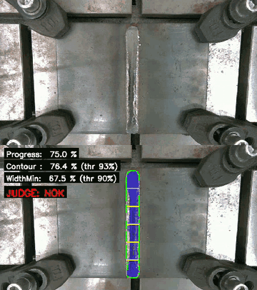
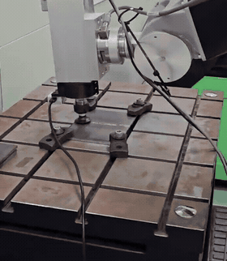
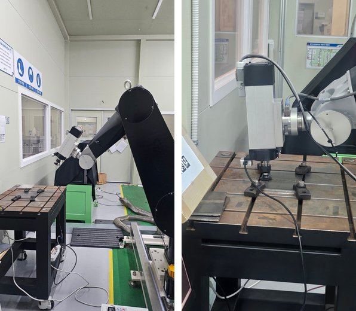
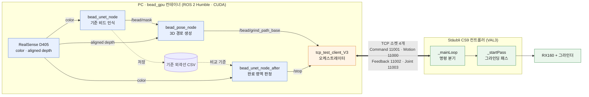
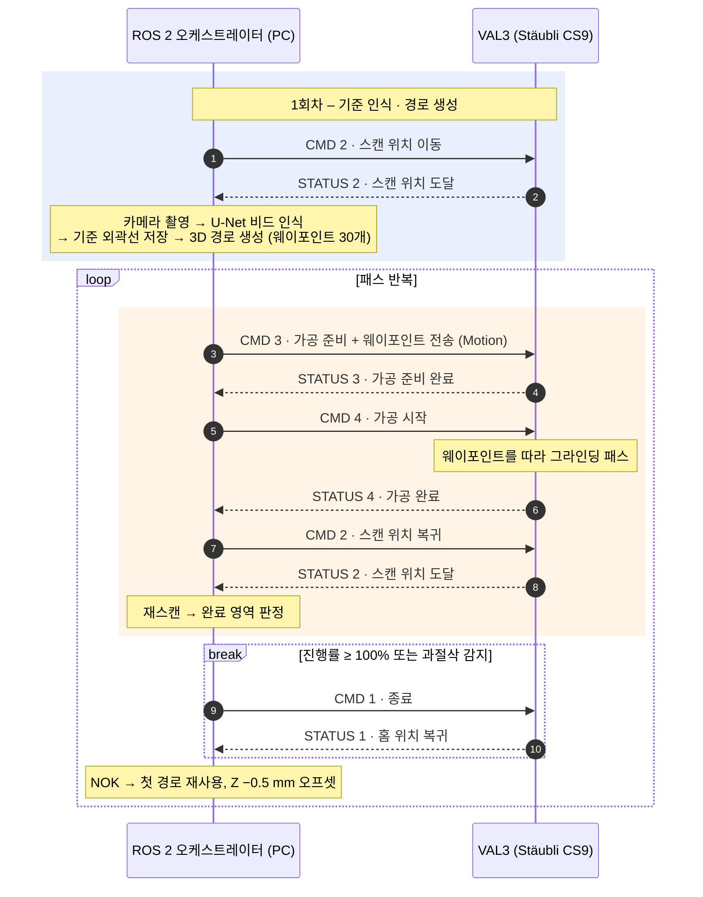
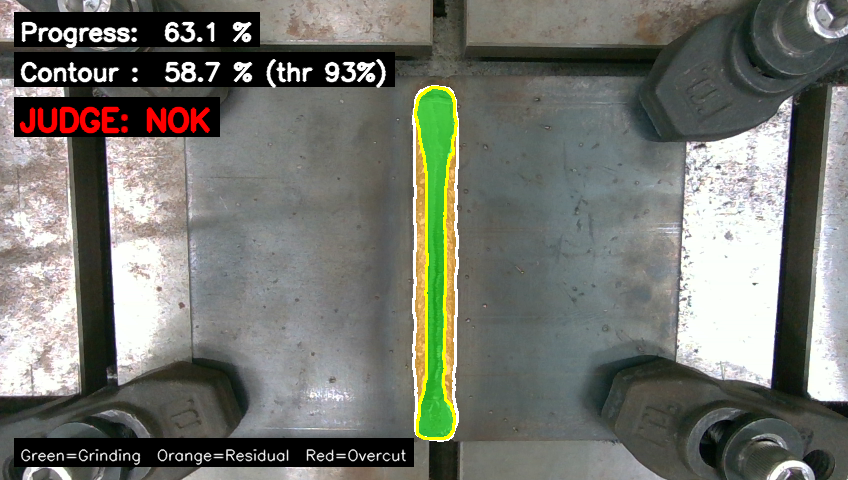
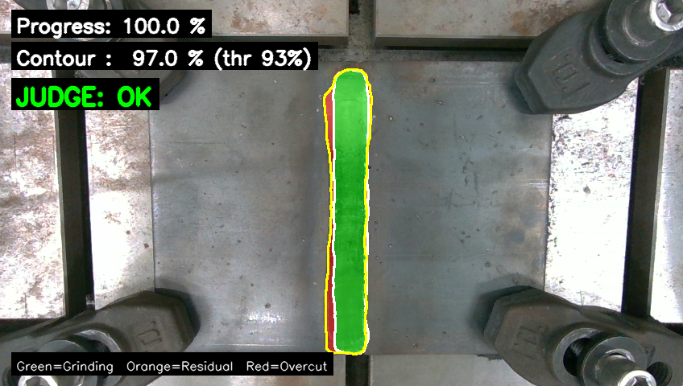

# 용접 비드 폐루프 자동 그라인딩 시스템

**연구실 과제 – 디지털 트윈을 이용한 로봇 원격 가공 (2차)** (2026.02 ~ 2026.04, 한국생산기술연구원)
<br><sub>1차 과제 [비전 기반 그라인딩 경로 생성 · 디지털 트윈](https://github.com/shfo2277/vision-grinding-digital-twin)을 확장 – 1차가 "어디를 가공할지"였다면, 2차는 "**언제까지 가공할지**"를 시스템이 스스로 판단</sub>

카메라로 용접 비드를 인식하고, 산업용 로봇(Stäubli RX160)이 비드를 그라인딩한 뒤 **다시 스캔해서 연삭이 끝났는지 스스로 판정**하는 자동화 시스템입니다.
판정이 OK가 나올 때까지 `스캔 → 경로 생성 → 그라인딩 → 재스캔 → 판정` 사이클을 반복합니다.

## 시연

<p align="center">
  
</p>

위: 그라인딩 중인 카메라 영상 / 아래: 재스캔 후 판정 오버레이 (기준 외곽선 대비 연삭 비율, OK/NOK)

▶ [전체 루프 시연 영상 (1분, 3배속)](docs/grinding_demo.mp4) – 터미널 로그, 카메라, 판정 화면이 함께 나오는 화면 녹화

### 실로봇 모션 검증 · 하드웨어

<table>
  <tr>
    <td align="center" width="32%"><br><sub>그라인더를 끈 상태로 생성한 경로를 실제 로봇이 비드를 따라 이동하는지 확인 (2배속) · <a href="docs/motion_check.mp4">MP4</a></sub></td>
    <td align="center"><br><sub>Stäubli RX160 + 스핀들 그라인더 + RealSense D405 · 정반 위에 고정한 용접 비드 시편</sub></td>
  </tr>
</table>

## 핵심 결과

- **완료 영역 인식 모델**: 가공 후 평탄화된 영역을 분할하는 U-Net – IoU **0.97** / Dice **0.98** / Precision **0.97** / Recall **0.99**, 추론 약 **39 ms**
- **종료 판정**: 기준 비드 외곽선 대비 완료 영역 **93% 이상이면 정상 종료**, 기준 밖 가공이 감지되면 **안전 정지**
- **핸드-아이 재캘리브레이션**: 35개 자세 → 이상치 제거 후 28개 사용, 잔차 평균 **0.73 mm** (중앙값 0.55 mm)
- **로봇 통신 직접 구현**: Python ROS 2 오케스트레이터 ↔ VAL3 프로그램을 **TCP 소켓 4개**로 연결, 자동 루프 + 단계별 수동 실행

## 시스템 구성



오케스트레이터가 인식·경로·판정 노드를 단계마다 subprocess로 실행·종료하고, 로봇과는 용도별로 나눈 TCP 소켓 4개로 통신합니다.

## 동작 시퀀스



진행률 = (기준 외곽선 내부 완료 영역 비율) ÷ 93%. 2회차부터는 비드 인식·경로 생성을 다시 하지 않고 첫 경로를 재사용합니다.

## 주요 기능

**1. 기준 비드 인식** – `nodes/bead_unet_node.py`
- 1차 과제의 비드 인식 U-Net(ResNet34, 입력 1024)을 재사용
- 연속 3프레임이 안정적일 때 결과를 확정(8초 타임아웃 시 최적 후보 확정)하고, 원본 해상도(1280×720)의 비드 외곽선과 폭을 CSV로 저장 → 이후 판정의 **기준(Reference)**

**2. 3D 그라인딩 경로 생성** – `nodes/bead_pose_node.py`
- 비드 마스크 + aligned depth → 카메라 3D 좌표 → 고정 스캔 자세 `T_world_tool0` × 핸드-아이 `T_tool0_cam`으로 world 좌표 변환
- depth 이상값 제거(median ± 3·MAD) 후 XY 평면 **PCA로 비드 방향**을 구해 웨이포인트 30개 생성 (Z = median)

**3. 로봇 통신 · 전체 루프** – `nodes/tcp_test_client_V3.py`, `VAL3_PA_grd_fin/`

| 채널 | 포트 | 역할 |
| --- | --- | --- |
| Motion | 11000 | 웨이포인트 좌표 전송 (float 배열) |
| Command | 11001 | 명령 전송 (1 = 홈, 2 = 스캔 위치, 3 = 가공 준비, 4 = 가공 시작) |
| Feedback | 11002 | 로봇 상태 수신 (0~4) |
| Joint | 11003 | 관절 값 수신 |

- Stäubli CS9 컨트롤러 쪽 VAL3 프로그램(명령·웨이포인트 수신, 상태·관절 송신, 스캔 위치 이동, 그라인딩 패스, 그라인더 IO)과 Python 오케스트레이터를 직접 작성
- 인식·경로·판정 노드를 subprocess로 실행/종료하며 사이클 관리
- **자동 모드**(`a`): 2회차부터는 첫 경로를 재사용하고 **Z축을 사이클마다 0.5 mm씩 내려가며** 반복 연삭
- **수동 모드**(`1`~`4`): 홈 / 스캔 / 경로 전송 · 가공 준비 / 가공 시작을 단계별로 실행 (개발 · 디버깅용)

**4. 종료점 판정** – `nodes/bead_unet_node_after.py`
- 재스캔 영상을 완료 영역 U-Net(1280 입력, 비율 유지 + 패딩)으로 분할하고, 패딩을 제거해 기준과 같은 원본 좌표계로 복원
- 기준 외곽선 내부의 완료 영역 비율이 **93%** 에 도달하면(진행률 ≥ 100%) OK
- **과절삭 판단 요소**: 기준 외곽선 밖에서 완료 영역이 검출되면 과삭 의심으로 정지 – 최종 코드는 **40 px 이상**, 실험에서는 기준 면적 대비 **5% 이상** 비율 기준으로도 바꿔 비교
- 결과를 색으로 표시: 🟩 연삭 완료 · 🟧 잔여 비드 · 🟥 기준 밖(과삭 후보)

<table>
  <tr>
    <td align="center"><br><sub><b>NOK</b> – 연삭 중간: contour 58.7%, 테두리에 잔여 비드(주황)</sub></td>
    <td align="center"><br><sub><b>OK</b> – 연삭 완료: contour 97.0% (기준 93%) → 자동 정지</sub></td>
  </tr>
</table>

**5. 핸드-아이 재캘리브레이션** – `calibration/`
- 근거리 가공 표면을 관측하기 위해 카메라를 D415 → **D405**로 바꾸면서 tool0–camera 관계가 달라져 다시 수행
- ArUco 보드로 eye-in-hand 캘리브레이션, 35개 로봇 자세에서 샘플 수집 → 재투영 오차·잔차 기준으로 걸러 28개 사용
- OpenCV 5가지 방법(TSAI, PARK, HORAUD, DANIILIDIS, ANDREFF)을 비교해 중앙값 잔차가 가장 작은 **TSAI** 선택 (`cal.py`)
- 로봇을 여러 자세로 움직여 보드 좌표 일관성으로 결과 검증 (`verify_node.py`)

## 모델 학습 · `train/bead_train_end.py`

| 항목 | 내용 |
| --- | --- |
| 모델 | `segmentation_models_pytorch` U-Net (ResNet34, ImageNet 사전학습), 완료 영역 이진 분할 |
| 데이터 | 가공 후 비드를 각도·조명·거리를 바꿔 직접 촬영 · 라벨링한 194장 (초기 Labelme 폴리곤 → Datature Nexus(SAM 기반 IntelliBrush)로 전환), random 70/15/15 (135/29/30, seed 42) |
| 입력 | 1280, 비율 유지 리사이즈 + 패딩 (`LongestMaxSize` + `PadIfNeeded`) |
| 손실 / 최적화 | BCE(pos_weight 자동 계산) + Dice / Adam 1e-4, ReduceLROnPlateau, EarlyStopping(patience 7) |
| 판정 threshold | 0.4 |
| 평가 | `evaluation.py` – IoU / Dice / Precision / Recall, GPU 추론 속도 |

## 한계 및 개선 방향

- 접촉 가공인데 힘 제어가 없음 → Force/Torque 센서 기반 impedance · admittance 제어
- 과삭 판정 기준(픽셀 수 / 면적 비율)이 고정 카메라·고정 스캔 자세 조건의 실험값 → morphology · 연결 요소 면적 기반으로 노이즈에 강하게 일반화
- 자동 루프에 최대 패스 제한이 없음 → MAX_PASS · timeout 추가, 정상 종료와 이상 정지를 별도 상태 코드로 분리
- threshold 0.4 선정 근거(PR curve 등)가 남아 있지 않음 → 검증셋 threshold sweep으로 선정

## 폴더 구조

```
├── nodes/             실시간 실행 ROS 2 노드 (인식 · 경로 · 판정 · 오케스트레이터)
├── VAL3_PA_grd_fin/   Stäubli 로봇 VAL3 프로그램
├── calibration/       핸드-아이 캘리브레이션 및 검증
├── train/             U-Net 학습 · 평가 · 라벨 변환
├── tools/             오프라인 판정 · 시각화 유틸리티
├── test/              카메라 · 뎁스 정확도 테스트
├── staubli_configs/   Stäubli 컨트롤러 설정 백업
├── docker/            GPU 컨테이너 Dockerfile
└── archive/           이전 버전 코드
```

파일별 자세한 설명은 [PROJECT_STRUCTURE.md](PROJECT_STRUCTURE.md), 실행 환경과 명령어는 [PROJECT_SUMMARY.txt](PROJECT_SUMMARY.txt)에 정리되어 있습니다.

## 개발 환경

| 구분 | 내용 |
| --- | --- |
| 로봇 | Stäubli RX160, CS9 컨트롤러 (VAL3) |
| 카메라 | Intel RealSense D405 (컬러 1280×720, 뎁스 848×480) |
| 인식 · 제어 | Docker 컨테이너 – Ubuntu 22.04, ROS 2 Humble, CUDA GPU, CycloneDDS |
| 호스트 | Ubuntu 24.04, ROS 2 Jazzy |
| 딥러닝 | PyTorch, segmentation_models_pytorch, albumentations, OpenCV |

> 학습 데이터(`REAL/`)와 모델 가중치(`modelresult/`, `*.pth`)는 저장소에 포함되어 있지 않습니다.
